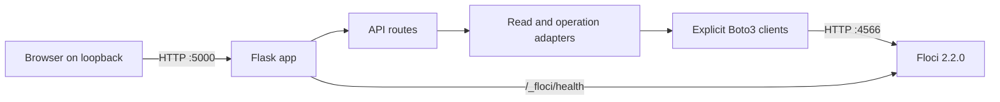

# LocalCloud Console Architecture

## Runtime Flow



The console is a separate Python process. It does not join or modify the Floci Compose project and does not restart Floci. The dashboard process binds to `127.0.0.1`; Boto3 clients use the configured local endpoint explicitly.

The frontend is a single-page vanilla JavaScript console. The command palette filters service navigation labels only. The Activity / Operations Log view reads `/api/operations` from Flask process memory.

## Project Structure

```text
app/
  __init__.py              Flask app factory and per-process state
  catalog.py               Service docs, evidence, and limitations
  clients.py               Explicit local Boto3 client provider
  config.py                Environment config and loopback validation
  routes.py                JSON API, health check, input/safety guards
  services/                AWS SDK operations separated from routes
  templates/index.html     Console shell
  static/app.css           Responsive UI styling
  static/app.js            Navigation, live inventory, and forms
tests/
  test_config.py
  test_clients.py
  test_routes.py
  test_read_integration.py
  test_write_integration.py
run.py                     Loopback-only Flask development entry point
requirements.txt           Direct Python dependencies
```

## Configuration

`AppConfig` reads:

- `FLOCI_ENDPOINT_URL`, default `http://127.0.0.1:4566`
- `AWS_REGION`, default `us-east-1`
- `AWS_ACCESS_KEY_ID`, default `test`
- `AWS_SECRET_ACCESS_KEY`, default `test`

Only HTTP loopback endpoints are accepted. Flask trusts loopback Host names only, checks mutation origins, uses bounded SDK timeouts, disables SDK retries, and keeps credentials out of JSON responses. S3 clients use path-style addressing. Errors sent to the browser contain safe error codes/messages, not stack traces or SDK diagnostics.

## Service Boundaries

Each service page calls its own adapter. CloudWatch Logs and Metrics, and API Gateway v1 and v2, are queried independently so a failed subservice is shown as unavailable without hiding successful sibling data. Empty arrays are rendered as empty inventory, not as proof that an operation is unsupported.

`catalog.py` links to the official Floci 2.2.0 service reference and labels tested operations separately from unvalidated operations. The UI lists Lambda functions and inspects configuration, and lists/inspects EC2 instance records. Lambda create/invoke/delete and EC2 lifecycle APIs exist on the Flask backend with session-ownership guards, but they are not shown in the UI because Floci's Docker-backed execution path has not been independently validated with this Compose file (the Docker socket is not mounted). Floci's documented EC2 instances are Docker-backed local containers rather than public VMs.

## Resource Safety

- Create names are checked for collisions before create requests.
- S3 upload checks that the bucket exists and refuses an existing object key.
- DynamoDB sample writes are limited to String-`pk` tables created by the current dashboard process and refuse to overwrite an existing key.
- SNS publish is blocked when any topic subscription exists; it is checked again immediately before publish.
- SQS accepts only queue URLs at the local Floci endpoint. Receipt handles remain server-side and are returned to the browser only through short-lived opaque delete tokens.
- Destructive object, message, bucket, table, queue, topic, log-group, and REST API actions require a typed exact-value confirmation. Those deletions (except selected S3 objects and received SQS messages) are limited to resources created during the current dashboard process.
- The app has no delete-all route and does not automatically remove dashboard-created resources.

Dashboard ownership markers and recent-operation history live in Flask process memory. After a Flask restart, existing DynamoDB tables and APIs remain visible but ownership-restricted sample writes/API deletion are unavailable through the app. Floci currently defaults to in-memory storage, so a Floci restart has separate state-loss implications.